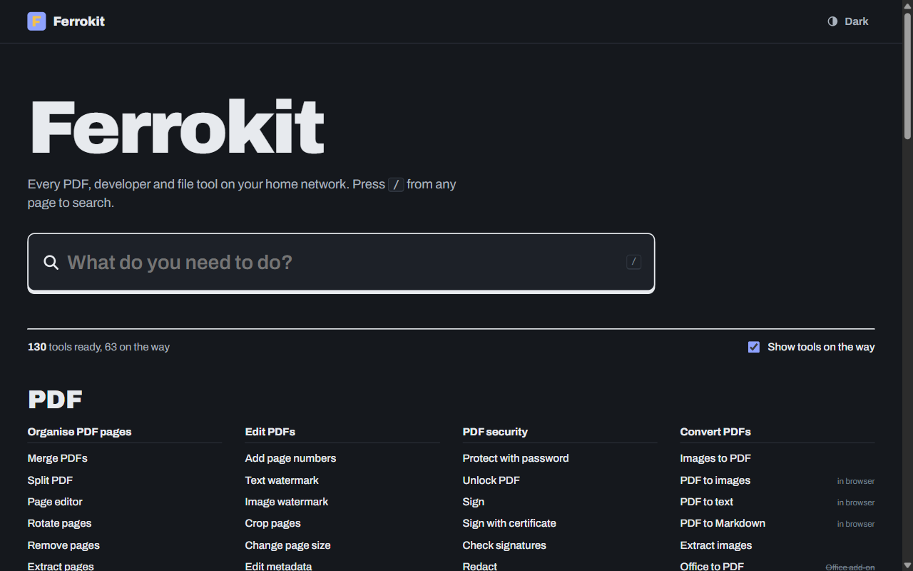
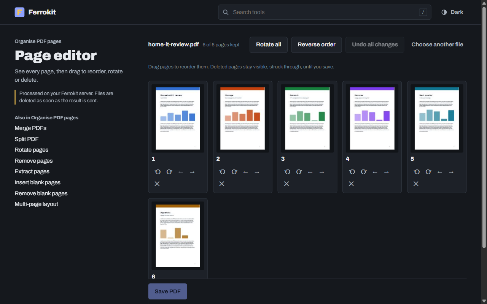
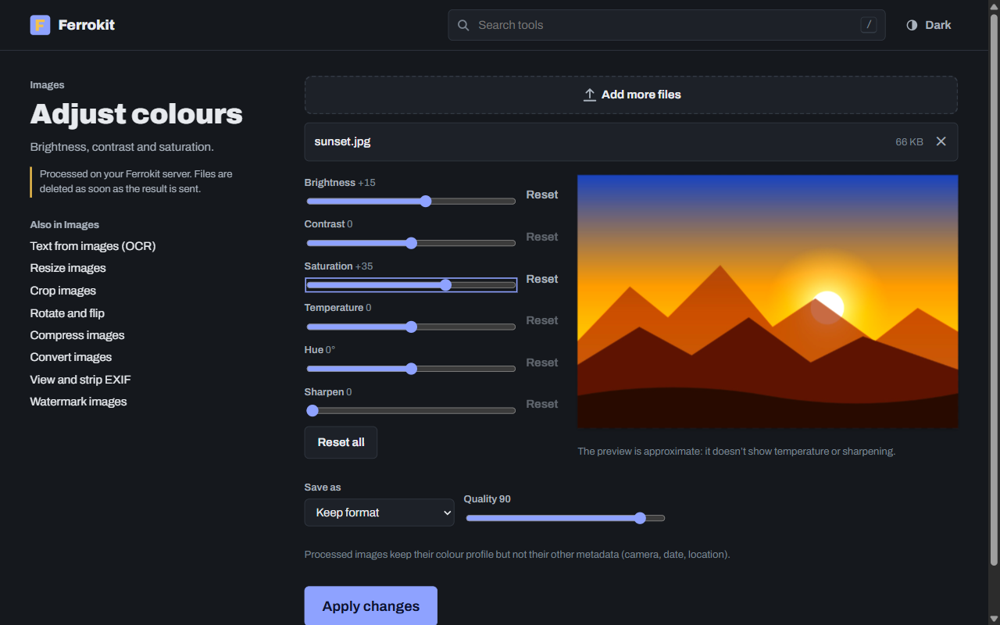
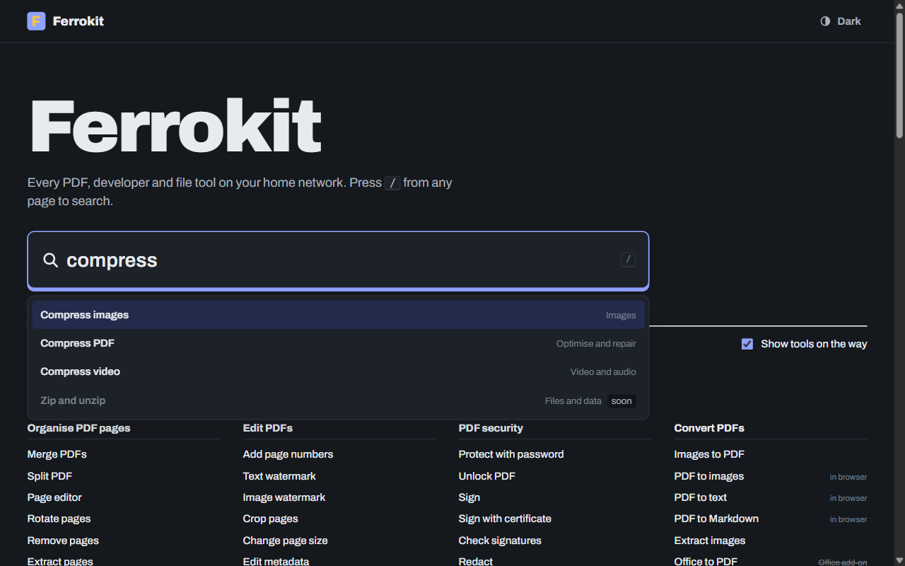

# Ferrokit

130 everyday tools for PDFs, images, video and code, running on your own server. Open it in any
browser on your home network. There are no accounts, and your files never go to someone else's cloud.



## What it does

**PDF (51 tools).** Merge, split and reorder pages. Compress, repair, and convert to PDF/A for
archiving. Add page
numbers, watermarks and signatures, fill in forms, redact, lock or unlock with a password, and compare
two versions of a document. Convert to and from Word, PowerPoint, images, Markdown and EPUB, and make
scanned documents searchable.

**Images (25 tools).** Resize, crop, compress and convert between JPG, PNG, WebP, AVIF and GIF. Strip
the location from photos, adjust colours, blur out faces or number plates, and make collages, GIFs,
passport photos and favicons. Turn a logo into an SVG, or copy the text out of a photo.

**Video and audio (22 tools).** Compress, trim, merge, resize and convert videos. Make GIFs, steady
shaky footage, add or pull out subtitles, and grab thumbnails. For audio: convert, trim, split, even
out the loudness, shift the pitch, and cut silence and background noise.

**Everyday and developer (32 tools).** QR codes (Wi-Fi ones too), a password generator and a text
compare, plus developer tools such as a JSON formatter, regex tester, JWT decoder and subnet calculator.

<p>
  
  
</p>

## Why use it

Your files stay at home. Light tools (text, QR codes, hashes, PDF to text and more) run entirely in
your browser and never upload anything. The rest run on your own server, work in memory, and delete
your files as soon as you have the result.

You don't need to know where a tool lives. Press `/` on any page and type what you want to do:
"compress", "rotate", "subtitles".

Long jobs carry on without you. Video work and searchable PDFs run in the background with a progress
bar and the time left, so you can close the tab and collect the result from the Jobs page within the
hour.

It stays small unless you need more. The core is a 19 MB download, and Office conversion, text
recognition and video are extras you switch on only if you want them.



## Get started

You need a computer on your network that runs Docker. Ferrokit is built and tested on 64-bit x86
(most PCs, mini PCs and Intel or AMD NAS boxes); ARM machines such as a Raspberry Pi aren't tested
yet. The core itself needs little memory; the add-ons below need more.

```sh
git clone https://github.com/nikhilsutaria/Ferrokit.git
cd Ferrokit
docker compose up -d --build
```

The first build compiles everything, so give it several minutes. Then open
`http://<your-server's-address>:8080` on any phone, tablet or computer on the same network.

### Optional extras

Some tools need a bigger engine, which comes as an add-on. A tool that needs one says so and shows the
command to start it.

| Add-on | What it adds | Download |
|---|---|---|
| Office | Word, Excel and PowerPoint to and from PDF; web pages, Markdown and EPUB to PDF; PDF/A | about 610 MB |
| OCR | Searchable PDFs from scans, and text from photos, in 160 languages and scripts | about 520 MB |
| Media | All 22 video and audio tools | about 300 MB |

Start the ones you want:

```sh
docker compose --profile office --profile ocr --profile media up -d --build
```

To update, run `git pull` and then the same `docker compose` command again.

## Keep it on your home network

Ferrokit has no logins. Anyone who can reach it can use every tool, and can see, download or cancel any
background job. That's fine at home, but don't open it to the internet. If you want it while you're
away, reach it through a VPN, or put a reverse proxy that asks for a password (such as Caddy or Nginx
Proxy Manager) in front of it. There's
more in [SECURITY.md](SECURITY.md).

## What's next

The home page also lists 63 tools that are on the way. Next up are local AI tools that run on your CPU
(background removal, upscaling, transcription), more file and data tools, and a way to chain tools
together.

## More

- [Self-hosting guide](docs/self-hosting.md): settings, memory, add-ons and background jobs
- [API](docs/api.md): use the tools from your own scripts
- [Contributing](CONTRIBUTING.md): build it, test it, add a tool
- [Security](SECURITY.md): how Ferrokit is locked down, and how to report a problem

## Licence

Ferrokit is free software under the [GNU General Public License v3.0](LICENSE). The optional add-ons
include other programs that have their own licences: see
[Bundled programs](docs/self-hosting.md#bundled-programs).
